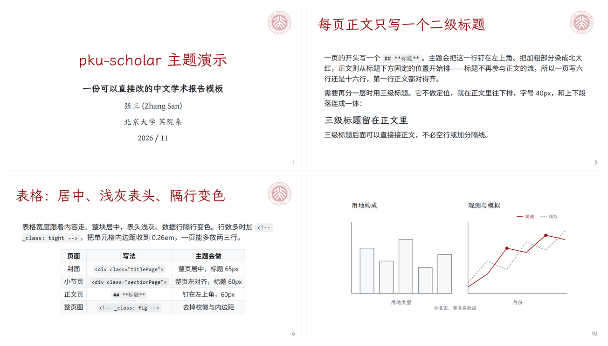

# pku-scholar

> 北京大学风格的中文学术报告 Marp 主题 —— 标题钉在左上角，封面与小节页整页居中，正文用霞鹜文楷 / 寒蝉正楷，右上角带校徽，表格、公式、引用都已调好。
>
> A Marp theme for Chinese academic talks, in the PKU visual style.



主题本体只有一个文件：`themes/pku-scholar.css`。它继承 Marp 官方默认主题（`@import 'default'`），只覆盖真正需要改的部分，因此列表、表格、代码块、引用这些排版都跟默认主题一致。

## 推荐用法：在 VS Code 里写、预览、导出 PDF

最省事的路线是 VS Code 加 [Marp for VS Code](https://marketplace.visualstudio.com/items?itemName=marp-team.marp-vscode) 扩展：左边写 Markdown，右边实时看幻灯片，要交稿时一条命令导出 PDF，全程不用碰终端。

### 1. 装扩展

在 VS Code 的扩展面板里搜索 **Marp for VS Code**（`marp-team.marp-vscode`）并安装。装完后打开任何写了 `marp: true` 的 Markdown，编辑器就会进入 Marp 模式。

### 2. 注册主题

主题不是内置的，得先告诉扩展 `themes/pku-scholar.css` 在哪。仓库里已经放好了工作区设置 `.vscode/settings.json`：

```json
{
  "markdown.marp.themes": ["./themes/pku-scholar.css"],
  "markdown.marp.html": "all"
}
```

| 设置 | 作用 |
| --- | --- |
| `markdown.marp.themes` | 主题 CSS 的路径列表。相对路径按**工作区根目录**解析，也可以写绝对路径或远程 URL；可以一次注册多个主题 |
| `markdown.marp.html` | 设为 `"all"` 才允许讲稿里的 HTML。封面、小节页、定理框都靠 `<div>` 实现，关掉它们会变成纯文本 |

自己写讲稿时，把这两行抄进你的工作区设置即可；主题文件放在别处就写绝对路径。

### 3. 实时预览

打开 `examples/demo.md`，用 Markdown 预览的常规方式打开右侧预览（编辑器右上角的预览图标，或 `Ctrl+Shift+V` / macOS `Cmd+Shift+V`）。预览就是幻灯片效果：

- 光标停在哪一页，预览就高亮哪一页；
- 改 `demo.md` 立刻刷新；
- 改 `themes/pku-scholar.css` 也会自动重新加载——调字号、调颜色时不用反复切换窗口。

编辑器标题栏右侧还有一个 Marp 图标，里面的 **Toggle Marp feature for current Markdown** 可以手动开关当前文件的 Marp 模式。

### 4. 导出 PDF

按 `F1`（或 `Ctrl+Shift+P` / macOS `Cmd+Shift+P`）打开命令面板，执行 **Marp: Export slide deck...**，选保存位置和格式即可；点工具栏 Marp 图标里的同名项也一样。

- 支持 **HTML / PDF / PPTX / PNG / JPEG / TXT**（后三者只导首页，TXT 只导演讲者备注）；
- 默认格式可以用 `markdown.marp.exportType` 设置；
- 导出 PDF、PPTX 和图片需要本机装有 Chrome、Chromium、Edge 或 Firefox，扩展用它们排版；只导 HTML 不需要浏览器；
- 浏览器类型可以用 `markdown.marp.browser` 指定（`chrome` / `edge` / `firefox` / `auto`），装在非默认位置时用 `markdown.marp.browserPath` 指路。

> **本地图片不需要额外开关。** 扩展导出时默认允许读取本地文件，所以 `images/pku-logo.png`、`images/*.svg` 会正常进 PDF——命令行那条 `--allow-local-files` 在这里不用加。

### 5. 两个可选设置

| 设置 | 作用 |
| --- | --- |
| `markdown.marp.diagnostics.slideContentOverflow` | 预览时提示“这一页内容溢出了画布”（实验特性，只在预览打开时生效） |
| `markdown.marp.strictPathResolutionDuringExport` | 导出时按工作区根目录解析相对路径，跟 VS Code 预览保持一致（默认按 Markdown 文件所在目录，与命令行一致） |

### 6. 打开的是别人的仓库？

VS Code 会先问是否信任该工作区。**不信任时**，扩展只给基础预览，导出命令与自定义主题都会被禁用——选“信任此工作区”即可。

### VS Code 路线需要什么

只需要：VS Code、Marp for VS Code 扩展、导出 PDF 时用的一个浏览器。**不需要 Node.js，也不需要命令行版的 marp**，扩展自带完整的渲染器。

## 依赖

| 依赖 | 用途 | 谁需要 | 版本 |
| --- | --- | --- | --- |
| [VS Code](https://code.visualstudio.com/) | 编辑与预览 | 推荐路线 | 任意较新版本 |
| [Marp for VS Code](https://marketplace.visualstudio.com/items?itemName=marp-team.marp-vscode) | 预览与导出 | 推荐路线 | 任意较新版本 |
| [Node.js](https://nodejs.org/) | 运行 marp CLI 与自检脚本 | **仅命令行路线** | ≥ 18（本仓库在 22.19.0 上验证） |
| npm | 安装 marp CLI、执行 `npm run` 脚本 | 命令行路线，可用 npx 或独立二进制替代 | 随 Node.js |
| [Marp CLI](https://github.com/marp-team/marp-cli) | 把 Markdown 转成 HTML / PDF / PNG / PPTX | **仅命令行路线** | ≥ 4.2.3（本仓库在 4.2.3 上验证） |
| Chrome / Chromium / Edge / Firefox | 驱动排版，导出 PDF / PPTX / 图片时需要 | 两条路线在导出 PDF 时都需要 | 任一较新版本 |
| 霞鹜文楷、寒蝉正楷体 | 标题与楷体字形 | 可选，缺失时回退到系统楷体 | 见「字体」 |
| git | 只用于取回仓库 | 可选 | 任意 |

- 主题 CSS 本身**没有任何运行时依赖**：`@import 'default'` 引入的是 marp 自带的默认主题，不需要联网、不需要额外下载 CSS。
- 本仓库**不依赖 Python**；`npm run check` 只用 Node 标准库。

## 命令行用法

不想开编辑器、或者要把导出写进脚本时走这条路。

### 方式一：零安装（npx）

只想看效果、或偶尔导一次：

```bash
npx @marp-team/marp-cli@4.2.3 --theme-set ./themes --html --allow-local-files --pdf talk.md -o talk.pdf
```

`npx` 会把 marp CLI 下到临时目录再执行，不写进当前项目。第一次运行需要联网。

### 方式二：装进项目（推荐长期使用）

仓库已经把 marp CLI 声明为 devDependency：

```bash
npm install          # 安装 @marp-team/marp-cli ^4.2.3 到 node_modules/
npm run build:pdf    # 用它导出 examples/demo.md
```

之后所有 `npm run` 脚本都会用本地这份 marp，版本可复现。

### 方式三：全局安装 / 独立二进制

```bash
npm install -g @marp-team/marp-cli      # npm 全局
brew install marp-cli                   # macOS / Homebrew
scoop install marp                      # Windows / Scoop
```

也可以从 [marp-cli Releases](https://github.com/marp-team/marp-cli/releases) 下载对应平台的单文件可执行程序，不需要 Node.js。

### 参数说明

```bash
# 从仓库根目录
marp --theme-set ./themes --html --allow-local-files --pdf talk.md -o talk.pdf

# 或者只指定这一个文件（此时不需要 --theme-set）
marp --theme ./themes/pku-scholar.css --html --allow-local-files --pdf talk.md -o talk.pdf
```

| 参数 | 作用 |
| --- | --- |
| `--theme-set ./themes` | 把这个目录下所有主题注册给 marp（目录或单个 CSS 文件都可以） |
| `--html` | 允许讲稿里的 `<div class="titlePage">` 这类 HTML —— 封面页、小节页、定理框都靠它 |
| `--allow-local-files` | 允许 PDF / PNG / PPTX 转换时读取本地图片。**校徽与配图都是本地文件，浏览器类输出必须加**，详见「关于 `--allow-local-files`」 |
| `-o` | 输出路径 |

HTML 输出不需要 `--allow-local-files`，也不需要浏览器：

```bash
marp --theme-set ./themes --html talk.md -o talk.html
```

### 安装后自检

```bash
marp --version
# @marp-team/marp-cli v4.2.3 (w/ @marp-team/marp-core vX.Y.Z)

npm run check
# ✓ themes/pku-scholar.css 通过自检：382 行 / 8.4 KB
```

`npm run check` 只读 `themes/pku-scholar.css`，不需要安装 marp，也不需要浏览器。

## 字体

两款字体都不是硬依赖，装不上也能出稿，只是字形会变。它们都是独立作者维护的开源字体，作者信息与下载地址见下方「致谢」：

- **霞鹜文楷**（CSS 里写作 `'霞鹜文楷'`，回退 `'LXGW WenKai'`）：标题、小节页标题。下载：<https://github.com/lxgw/LxgwWenKai>。
- **寒蝉正楷体**（CSS 里写作 `'ChillKai'`）：封面作者行、引用、定理内容。下载：<https://github.com/Warren2060/Chillkai>。

两款字体的回退栈都以 `KaiTi` / 楷体 / `STKaiti` / `serif` 结尾，所以没装字体时依旧能渲染。

## 使用主题

### 1. 把主题文件放到讲稿旁边

主题一共两样东西：一个 CSS 文件，和一张校徽图片。所谓「放对位置」，指的是这两样东西**相对你的讲稿**摆在哪儿 —— Marp 认的是路径，没有「安装到系统里」这一步。

最小可用的目录长这样：

```
我的报告/
├── talk.md                 ← 你的讲稿，文件名随意
├── themes/
│   └── pku-scholar.css     ← 主题文件
└── images/
    └── pku-logo.png        ← 校徽；缺了它，右上角就是空白
```

从仓库里把这两样东西复制过去（在仓库根目录执行，`我的报告` 换成你自己的路径）：

```powershell
# Windows PowerShell
$dest = "$env:USERPROFILE\Desktop\我的报告"
New-Item -ItemType Directory -Force -Path "$dest\themes", "$dest\images" | Out-Null
Copy-Item themes\pku-scholar.css "$dest\themes\"
Copy-Item examples\images\pku-logo.png "$dest\images\"
```

```bash
# macOS / Linux
mkdir -p ~/Desktop/我的报告/{themes,images}
cp themes/pku-scholar.css ~/Desktop/我的报告/themes/
cp examples/images/pku-logo.png ~/Desktop/我的报告/images/
```

然后在**这个文件夹里**写讲稿、跑命令：

```powershell
cd "$env:USERPROFILE\Desktop\我的报告"
marp --theme-set themes --preview talk.md
```

三个最容易搞错的地方：

| 你填的东西 | 相对谁算 | 放错时的症状 |
|---|---|---|
| `--theme-set themes` | 你**运行命令时所在的目录** | 在别的目录里跑：报找不到主题，或悄悄用了默认主题 |
| front matter 的 `theme: pku-scholar` | 是**名字**，不是路径 | 名字和 CSS 里的 `@theme pku-scholar` 不一致 → 主题不生效 |
| 主题里的 `url('./images/pku-logo.png')` | **讲稿所在目录**，不是 CSS 所在目录 | 把 `images/` 放到 `themes/` 旁边 → 校徽静默消失 |

最后一条最反直觉：校徽虽然写在主题 CSS 里，却是按**讲稿的位置**去找文件的。所以 `images/` 永远跟讲稿同级。

想省事就直接把整个 `examples/` 复印成自己的文件夹，位置天然是对的：

```powershell
New-Item -ItemType Directory 我的报告
Copy-Item examples\* 我的报告 -Recurse
Rename-Item 我的报告\demo.md talk.md
```

**VS Code 里同理**：`.vscode/settings.json` 里的 `markdown.marp.themes` 相对**工作区根目录**算，默认值 `./themes/pku-scholar.css` 对应的就是上面这个结构；换到自己的文件夹时，记得把 `themes/` 和 `images/` 一起带过去（操作步骤见开头「推荐用法」）。

放好之后先验一眼：预览里右上角有校徽、标题是北大红，就说明路径都对了。只看到正文、没有校徽，多半是 `images/` 位置不对 —— 导出时 Marp 会提示 `The local file is missing and will be ignored.`。

### 2. 讲稿开头写 front matter

```markdown
---
marp: true
theme: pku-scholar
paginate: true
math: katex
---
```

- `theme: pku-scholar` 对应 `themes/pku-scholar.css` 里 `@theme pku-scholar` 的声明，名字必须一致。
- `math: katex` 打开公式排版（`$...$` 与 `$$...$$`）。

### 3. 一页怎么写

一篇讲稿只用三种页面骨架：

```markdown
<!-- 封面页：整页居中 -->
<div class="titlePage">

# **讲的题目**
## 副标题可以放英文题目

作者名 (Author Name)

单位

2026 / 11

</div>

---

<!-- 小节页：整页左对齐 -->
<div class="sectionPage">

# 第一部分

</div>

---

<!-- 正文页：只放一个二阶标题，主题把它钉在左上角 -->
## **这一页的标题**

- 正文从这里开始
```

- 正文页的标题写在**第一个** `##`，并用 `**` 加粗 —— 加粗走北大红（`--pku-accent`），这是主题的视觉签名。
- 需要小节标题时用 `###`，它留在正文流里。
- 结尾页可以再套一次 `titlePage`。

### 4. 工具类

带 `_class` 的是逐页指令，写在那一页开头：

| 写法 | 作用 |
| --- | --- |
| `<!-- _class: dense -->` | 列表 28px、段落间距收紧，适合条目多的页 |
| `<!-- _class: tight -->` | 表格单元格 padding 收到 0.26em，适合行多的表 |
| `<!-- _class: xs -->` | 表格字号 25px |
| `<!-- _class: refs -->` | 参考文献页：23px 小字、1.35 行距 |
| `<!-- _class: fig -->` | 整页图：去掉校徽与内边距，图片顶到画布边 |
| `<div class="theorem">` | 定理框：两列表格，左窄列放「定义 1」这类标签 |

多个类可以叠加：`<!-- _class: dense tight -->`。

这些类的选择器都用 `:where()` 压低了优先级，所以讲稿里的 `<style>` 永远能盖住它们，不需要 `!important`。

### 5. 换字体 / 换颜色 / 换校徽

讲稿里覆盖变量即可，不用改主题文件：

```html
<style>
section {
  --pku-serif: 'Source Han Serif SC', 'Songti SC', serif; /* 标题字体 */
  --pku-kai: 'Kaiti SC', serif;                            /* 楷体：引文、定理、作者行 */
  --pku-accent: #c00000;                                   /* 标题里加粗部分的颜色 */
}
</style>
```

可用的令牌：

| 变量 | 默认值 | 管什么 |
| --- | --- | --- |
| `--pku-serif` | 霞鹜文楷 → KaiTi → serif | 各级标题 |
| `--pku-kai` | ChillKai → KaiTi → serif | 引文、定理内容、封面作者行 |
| `--pku-ink` | `#000` | 标题主色 |
| `--pku-accent` | `#94070a` | 标题里加粗部分的颜色 |
| `--pku-logo` | `url('./images/pku-logo.png')` | 右上角校徽 |

#### 换校徽

校徽就是一个图片文件，放在讲稿同级的 `images/pku-logo.png`：

```bash
# 换成自己的标识：直接覆盖同名文件即可，CSS 不用动
cp my-logo.png images/pku-logo.png
```

想换路径或去掉校徽，在讲稿里覆盖一行：

```html
<style>
section {
  --pku-logo: url('./images/my-logo.svg'); /* 换路径 */
  /* --pku-logo: none;                      去掉校徽 */
}
</style>
```

因为校徽是本地文件，命令行导出 PDF / PNG / PPTX 时需要 `--allow-local-files`（见下节）；用 VS Code 扩展导出则不用管。整页图（`.fig`）会关掉校徽，不受影响。

> 北京大学校徽属于学校标识，仅适合校内学术报告使用；公开分发或商业用途请替换为自有标识或移除，详见「许可」。

## 构建与发布

```bash
npm run check      # 主题自检（改完主题必跑）
npm run preview    # 本地预览 examples/demo.md
npm run build      # check + 导出 demo 的 HTML 与 PDF
npm run build:pdf  # 只导出 PDF
npm run build:png  # 导出逐页 PNG（examples/demo.001.png …）
```

这些脚本里，预览与构建都调用 `marp --theme-set themes`，并且 PDF / PNG 脚本已经带上了 `--allow-local-files`。

### 用 GitHub Pages 发布 demo

`.github/workflows/pages.yml` 会在每次 push 到 `main` 时把 demo 构建成 `_site/index.html` 并部署：HTML 与 `examples/images/` 一起进 `_site/`，因此网页上的校徽也能正常显示。在仓库的 **Settings → Pages** 里把 Source 选成 **GitHub Actions** 即可。

### 关于 `--allow-local-files`

这个开关只影响「浏览器类输出」（PDF / PNG / PPTX）：不加它，marp 会用 `data:` 页面渲染，浏览器出于安全策略拒绝读取本地图片，校徽和配图会静默消失，marp 同时打印：

```text
[  WARN ] Marp CLI has detected accessing to local files. They are blocked by
          security reason. Instead we recommend using assets uploaded to online.
          (Or you can use --allow-local-files option if you are understood of
          security risk)
```

只导出 HTML 时没有这个限制（HTML 只是引用相对路径）。

## 目录结构

```
.
├── themes/pku-scholar.css        # 主题本体（唯一需要被 marp 加载的文件）
├── examples/demo.md              # 12 页完整模板
├── examples/images/pku-logo.png  # 校徽（直接替换这个文件即可）
├── examples/images/*.svg         # demo 用的示意图（手绘 SVG，可替换）
├── assets/preview-v2.png         # README 预览图
├── .vscode/settings.json         # 注册主题的 VS Code 工作区设置
├── scripts/check-theme.mjs       # 主题自检
└── .github/workflows/pages.yml   # 用 GitHub Pages 发布 demo
```

## 常见问题

**VS Code 预览没套上主题**

1. `.vscode/settings.json` 里 `markdown.marp.themes` 的路径要指向真实的 CSS 文件（相对工作区根目录）；
2. 讲稿 front matter 的 `theme:` 名字要和 CSS 里 `@theme` 一致（这里是 `pku-scholar`）；
3. 改完设置执行一次 **Reload Window**（命令面板里搜 `Reload Window`）。

**封面页的 `<div>` 变成了普通文本**

`markdown.marp.html` 没设成 `"all"`；另外不信任的工作区会强制忽略 HTML。

**VS Code 导出 PDF 报找不到浏览器**

装 Chrome / Chromium / Edge / Firefox 之一，或用 `markdown.marp.browserPath` 指定已有浏览器的路径。

**校徽或配图不显示**

1. 路径是相对**讲稿所在目录**解析的：讲稿若在 `my-talk/talk.md`，校徽就要在 `my-talk/images/pku-logo.png`；
2. 命令行导出 PDF / PNG / PPTX 时必须加 `--allow-local-files`，否则本地图片会被浏览器拦掉，日志里会出现 `Marp CLI has detected accessing to local files. They are blocked by security reason.`；
3. 文件名不对时 marp 会提示 `The local file is missing and will be ignored. Make sure the file path is correct.`。

**字体不是霞鹜文楷 / 寒蝉正楷**

没装对应字体，走了回退栈。装上字体即可，或在讲稿里用 `--pku-serif` / `--pku-kai` 指定本机已有的字体。

**转 PDF 报找不到浏览器（命令行）**

marp 的 PDF / PNG / PPTX 输出依赖本机已安装的 Chrome、Edge 或 Firefox，装一个即可（HTML 输出不需要）。

**路径里有空格**

命令行里给路径加引号，例如 `marp --theme-set themes --pdf "my talk.md"`。

## 致谢

主题的默认字体都是个人作者长期维护的开源字体。本仓库不打包、也不分发任何字体文件，只在 CSS 里按字体名引用；请从作者本人的仓库下载安装，并遵守各自的许可。

| 字体 | 作者 | GitHub 仓库（下载） | 许可 |
| --- | --- | --- | --- |
| 霞鹜文楷 LXGW WenKai | lxgw（落霞孤鹜） | <https://github.com/lxgw/LxgwWenKai> | SIL OFL 1.1 |
| 寒蝉正楷体 ChillKai | 寒蝉字型 ChillType（Warren2060 维护） | <https://github.com/Warren2060/Chillkai> | SIL OFL 1.1 |

霞鹜文楷改造自 FONTWORKS 的 Klee One，寒蝉正楷体由「全字库正楷体」与 Gentium 合并调整而来——两款上游字体同样值得感谢。

两款字体均以 SIL Open Font License 1.1 发布：可以自由使用、修改、再分发，也能随同作品商用，但不能单独售卖字体文件本身；霞鹜文楷还声明了保留字体名称（「霞鹜」「LXGW」），若拿它改作新字体，需要另取名字。

主题本身建立在 [marp-team](https://github.com/marp-team) 的 Marp CLI 与 Marp Core 之上，一并感谢 Yuki Hattori 与所有贡献者。

## 许可

代码以 MIT 许可发布，见 [LICENSE](LICENSE)。

字体不随仓库分发，分别遵循作者的 SIL OFL 1.1 许可，作者与下载地址见「致谢」。

北京大学校徽（`examples/images/pku-logo.png`）**不在 MIT 授权范围内**，版权归北京大学所有；仓库里包含它只是为了方便校内报告直接使用。对外发布、商用或再分发前请替换为自有标识，或把 `--pku-logo` 设为 `none` 移除。
