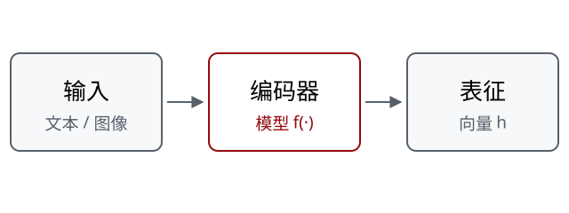
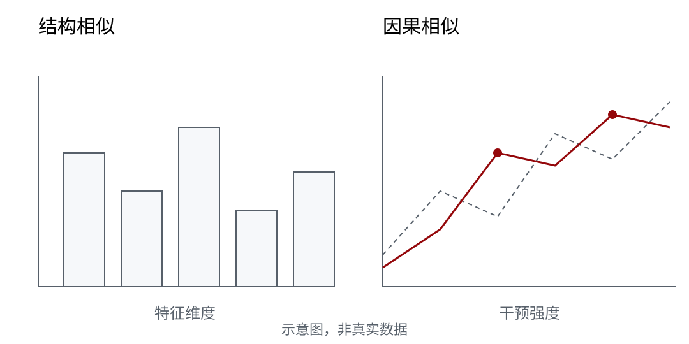

<div class="titlePage">

# **pku-scholar 主题演示**

## 一份可以直接改的中文学术报告模板

张三 (Zhang San)

北京大学 哲学系

2026 / 11

</div>

---

<div class="sectionPage">

# 一页的结构

</div>

---

## **每页正文只写一个二级标题**

一页的开头写一个 `## **标题**`。主题会把这一行钉在左上角、把加粗部分染成北大红，正文则从标题下方固定的位置开始排——标题不再参与正文的流，所以一页写六行还是十六行，第一行正文都对得齐。

需要再分一层时用三级标题。它不做定位，就在正文里往下排，字号 40px，和上下段落连成一体：

### 三级标题留在正文里

三级标题后面可以直接接正文，不必空行或加分隔线。

---

<!-- _class: dense -->

## **条目多的时候，加一行 dense**

默认正文字号 30px，一页放到七八条就到底了。在页面开头加一行 `<!-- _class: dense -->`，列表字号收到 28px、段落间距收到 0.35em，同样的画布能多放两三行，不必逐条缩字号。

- 逐页指令写在 `---` 之后、标题之前，只对当前这一页生效
- 多个类可以叠加，写成 `<!-- _class: dense tight -->`
- 主题里的工具类都用 `:where()` 压低了优先级，讲稿里的 `<style>` 不写 `!important` 也盖得住
- 想换字体或配色，覆盖 `--pku-serif`、`--pku-accent` 这些变量即可，不必改主题文件

---

<div class="sectionPage">

# 排版元素

</div>

---

<!-- _class: tight -->

## **表格：居中、浅灰表头、隔行变色**

表格宽度跟着内容走、整块居中，表头浅灰、数据行隔行变色。行数多时加 `<!-- _class: tight -->`，把单元格内边距收到 0.26em，一页能多放两三行。

| 页面 | 写法 | 主题会做 |
| --- | --- | --- |
| 封面 | `<div class="titlePage">` | 整页居中，标题 65px |
| 小节页 | `<div class="sectionPage">` | 整页左对齐，标题 60px |
| 正文页 | `## **标题**` | 钉在左上角，60px |
| 整页图 | `<!-- _class: fig -->` | 去掉校徽与内边距 |

---

## **引用与定理**

引用用 `>`，主题把字号收到 25px 并加一条竖线，适合放论文原句：

> 表征不是符号的影子，而是可被操作的结构。
>
> —— 匿名审稿人

定理用 `<div class="theorem">` 包一张两列表：左窄列放标签，右列写内容，两列都左对齐。

<div class="theorem">
  <table>
    <tr><th>定义 1</th><td>若两个表征在干预下保持同构，则称它们承载相同的特征。</td></tr>
    <tr><th>性质</th><td>这种同构是等价关系：自反、对称、传递。</td></tr>
  </table>
</div>

---

## **公式与代码**

行内公式跟正文同一字号，例如 $h \in \mathbb{R}^{d}$ 就嵌在句子里；行间公式单独居中，并放大到 1.1em：

$$
\cos(h_1, h_2) = \frac{\langle h_1,\, h_2 \rangle}{\lVert h_1 \rVert \, \lVert h_2 \rVert}
$$

代码块保留默认主题的等宽字体和浅灰底，行内代码则跟着正文走：

```js
const cosine = (a, b) => dot(a, b) / (norm(a) * norm(b));
```

---

## **图片**

普通配图直接写 Markdown，主题把最大高度压到 288px、宽度 90% 并居中；需要更大就写 ``。



整页只放一张图时用 `<!-- _class: fig -->`，内边距与校徽都会去掉。

---

<!-- _class: fig -->



---

<!-- _class: refs -->

## **参考文献**

参考文献页把字号收到 23px、行距 1.35，条目多一些也放得下。下面是占位条目，换成自己的即可：

1. Author A, Author B. *Title of the Paper*. Journal of Something, 2024, 12(3): 45–67.
2. Author C. *Another Book Chapter*. In: Edited Volume. Publisher, 2023: 101–120.
3. 作者丁. 一篇中文论文的标题. 某学报, 2025, 40(2): 1–18.

<small>以上均为占位条目，发表前请替换为真实文献。</small>

---

<div class="titlePage">

# **谢谢**

## Thank you

张三 · 2026 / 11

</div>
